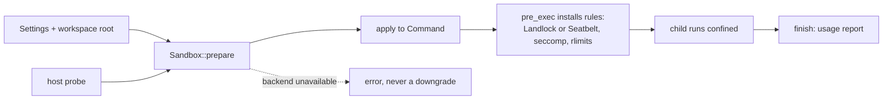

# kekkai (結界)

**Sandbox a child process from Rust: allow these paths, deny the network, cap resources — applied to a `Command` before it spawns.**

[](https://github.com/Sannrox/kekkai/actions/workflows/ci.yml)
[](https://github.com/Sannrox/kekkai/releases)
[](https://github.com/Sannrox/kekkai/blob/main/LICENSE)

[Try it](#try-it) · [Consumer guide](https://github.com/Sannrox/kekkai/blob/main/docs/consumer-guide.md) · [Examples](https://github.com/Sannrox/kekkai/blob/main/examples/README.md) · [Decisions](https://github.com/Sannrox/kekkai/blob/main/docs/decisions/README.md) · [Changelog](https://github.com/Sannrox/kekkai/blob/main/CHANGELOG.md)

> Not yet published to crates.io; consumers pin a
> [git tag](https://github.com/Sannrox/kekkai/releases). kekkai follows
> semver, and any change to what the sandbox allows or denies is a versioned
> change — in 0.x, a minor bump.

Kekkai (結界, a protective barrier) confines a child process before it
spawns. You build a `Settings` value, prepare a sandbox against a workspace
root, and apply it to a `std::process::Command`: on Linux a filesystem
allowlist (Landlock), a syscall and network gate (seccomp), and resource
limits; on macOS a Seatbelt profile for filesystem and network rules.
Deciding what runs, retries, and auditing stay with the caller
([ADR 0002](https://github.com/Sannrox/kekkai/blob/main/docs/decisions/0002-reusable-process-sandbox-library.md)).

- **Filesystem allowlist.** The child reads and writes only the paths you
  grant, with named roles for read-only inputs, a writable output, and a
  private per-run scratch directory.
- **No network by default.** Socket creation is denied unless you allow it,
  permit listed hosts through a parent CONNECT proxy, or isolate the child to
  loopback.
- **Resource limits.** Rlimits always; opt-in cgroup v2 memory, pids, CPU,
  and IO caps, with live usage snapshots and a report after exit.
- **Fail closed.** Selecting a backend the host cannot provide is an error,
  never a silent downgrade; `health` and `capabilities` report what the host
  supports.
- **In-process, no daemon.** The default backends install rules in
  `pre_exec`, so they need no helper; an opt-in userspace guest helper covers
  mutually distrusting runs.
- **A CLI for non-Rust callers.** `kekkai run` is the same prepare/spawn path
  with a JSON run report.

## Try it

From a fresh clone (the toolchain is pinned in `rust-toolchain.toml`), spawn
a shell that may write only inside the workspace:

```sh
git clone https://github.com/Sannrox/kekkai && cd kekkai
mkdir ws
cargo run --locked --bin kekkai -- run --workspace ws -- \
  /bin/sh -c 'echo hello > ws/out.txt && cat ws/out.txt; touch /tmp/escape || echo "outside the workspace: denied"'
```

The write inside the workspace succeeds, the write outside fails, and a JSON
`RunReport` follows on stderr (output observed on macOS, where the default
backend is `macos`):

```text
hello
touch: /tmp/escape: Operation not permitted
outside the workspace: denied
{"schema_version":1,"settings":{"backend":"macos","network":"deny",...
```

On Linux the default backend is `linux_native` (Landlock ABI 3 or newer plus
seccomp) and the same write is denied there; on other platforms the default
is `rlimit`, which enforces no filesystem rules. See the
[consumer guide](https://github.com/Sannrox/kekkai/blob/main/docs/consumer-guide.md) for backends, `health`, recommended
settings, and failure modes.

From Rust, the same path is three calls:

```rust,no_run
# fn main() -> Result<(), Box<dyn std::error::Error>> {
use std::process::Command;
use kekkai::{Backend, Sandbox, Settings};

let settings = Settings::builder()
    .backend(Backend::LinuxNative)
    .build();
let sandbox = kekkai::Sandbox::prepare(&settings, "/path/to/workspace")?;
let mut cmd = Command::new("python3");
sandbox.apply(&mut cmd)?;
let status = cmd.status()?;
# let _ = status;
# Ok(())
# }
```

Runnable sketches of the two known workloads are in
[`examples/`](https://github.com/Sannrox/kekkai/blob/main/examples/README.md).

## How it works



A **backend** names the enforcement the caller requires: `none` (development
only), `rlimit`, `linux_native`, `macos`, or `userspace`. **`Settings`**
(built with `Settings::builder`) carries the paths, network policy, and
limits. **`Sandbox::prepare`** validates the settings against what the host
kernel actually provides and fails closed when something is missing;
**`apply`** registers the enforcement on a `std::process::Command` so the
rules install between fork and exec. **`health`** and **`capabilities`**
report host support up front, and a **`Host`** snapshot lets a runner probe
once instead of per job. After exit, **`finish`** reports usage and observed
violations. The `userspace` backend owns spawn through a helper instead of
`apply` ([ADR 0003](https://github.com/Sannrox/kekkai/blob/main/docs/decisions/0003-guest-backend-interface.md)).

**Why not an existing sandboxing tool?** The first-tier backends avoid
unprivileged user namespaces, which several common distributions and default
container profiles restrict, so kekkai keeps working inside containers and
locked-down hosts; and a library gives callers typed errors, host health,
and semver on enforcement instead of a binary to wrap. The reasoning and the
rejected alternatives are in
[ADR 0002](https://github.com/Sannrox/kekkai/blob/main/docs/decisions/0002-reusable-process-sandbox-library.md).

## What it does

- **Filesystem allowlist:** the child can read and write only the paths you
  allow (Landlock ABI 3+ on Linux, Seatbelt on macOS). Named roles:
  read-only `inputs`, a writable `output` directory (the workspace when
  unset), and a private per-run scratch dir (`TMPDIR`). Overlapping roles
  are rejected. Extra device nodes are listed in `Settings.devices` on
  Linux; none are granted by default beyond `/dev/null`, `/dev/zero`,
  `/dev/urandom`, and `/dev/random`.
- **No network by default:** on Linux a seccomp filter denies socket
  creation; on macOS the Seatbelt profile denies `network*`.
  `Network::Allow` leaves sockets to the host; filesystem rules still apply.
  `Network::Allowlist` permits listed hosts through a parent CONNECT proxy
  on a unix socket; direct IP sockets fail. `Network::Loopback` places the
  child in a private network namespace with only loopback up.
- **Resource limits:** rlimits, plus opt-in cgroup v2 `memory.max`,
  `pids.max`, `cpu.max`, `cpu.weight`, and `io.max` when a delegated
  subtree is available. Requesting cgroup limits without one, or a
  controller the subtree does not provide, is an error, never a
  fallback to `RLIMIT_AS`. `Sandbox::usage` snapshots live usage;
  `finish` reports after exit.
- **Explicit backends:** `none` (development only), `rlimit`,
  `linux_native`, `macos` (Seatbelt filesystem and network profile), and
  `userspace` (opt-in `guest` cargo feature). Selecting a backend the
  kernel cannot provide is an error, never a silent downgrade.
- **Host detection:** `health` and `capabilities` report which backends the
  running kernel supports. `Host::probe` snapshots that once;
  `Sandbox::prepare_with_host` reuses the snapshot so a runner does not
  re-probe between jobs. A stale snapshot fails closed. `ChildUsage.violations` records seccomp-denied
  syscalls when user notification is available, and CONNECT denials from
  the egress proxy. Filesystem Landlock denials are reported as unavailable
  until the host exposes an unprivileged event stream.
- **In-process by default:** `rlimit`, `linux_native`, and `macos` install
  rules in `pre_exec`, so they work without a helper. Extra file
  descriptors above stderr do not survive `exec`; `ptrace` is denied.
  `SyscallProfile::Default` is the historical denylist; `Strict` and
  `Python` are per-architecture allowlists. `Namespaces::Isolate` is
  opt-in user/mount/PID/IPC/UTS namespaces when the host allows them.
  `FilesystemView::Isolate` adds read-only binds, tmpfs scratch, and an
  overlay whose writes are discarded or kept. `Network::Loopback` adds a
  private network namespace with only loopback up.
- **Userspace guest:** `Backend::Userspace` (cargo feature `guest`)
  launches a helper that owns spawn. The helper is the process-group
  leader; the payload stays in that group. `apply` is invalid on that
  sandbox. A missing helper is unavailable. See
  [ADR 0003](https://github.com/Sannrox/kekkai/blob/main/docs/decisions/0003-guest-backend-interface.md).

### Deadlines, capture, and async

`Sandbox::spawn_with_deadline` kills the process group after a wall-clock
limit (`SIGTERM`, then `SIGKILL` and `cgroup.kill`).
`Sandbox::spawn_with_deadline_captured` keeps stdout and stderr under
per-stream byte caps (head, tail, or both) and drains overflow so the
child cannot fill the pipe. The tokio captured helper waits on the
calling thread.

`tokio::process::Command` is supported behind the `tokio` cargo feature
(`Sandbox::apply_tokio`, `Sandbox::spawn_with_deadline_tokio`,
`Sandbox::spawn_with_deadline_captured_tokio`).
`Sandbox::report` is a JSON run report (schema version 1). The `tracing`
cargo feature adds `kekkai.prepare`, `kekkai.apply`, and `kekkai.finish`
spans.

## CLI

`kekkai run` prepares the same sandbox as the library and spawns a command:

```bash
kekkai run --settings job.json --workspace ./ws -- python3 job.py
kekkai run --backend none --report out.json -- /usr/bin/true
```

The child inherits stdin, stdout, and stderr. After it exits, a JSON
`RunReport` (`schema_version` 1) is written to stderr, or to `--report PATH`
(`-` or `--json` for stdout). The process exit code is the child's
(or `128+N` when signaled). Usage errors and prepare/apply/spawn failures
exit 2. Default backend is `linux_native` on Linux, `macos` on macOS, and
`rlimit` elsewhere. `kekkai --help` documents flags and the JSON file.

## Non-goals

- Scheduling, image management, or orchestration of containers or VMs.
- Deciding what runs, retries, or auditing. That belongs to the caller.
- Letting the child open its own IP sockets to listed hosts.
  `Network::Allowlist` is a parent CONNECT proxy on a unix socket.
- Real isolation on Windows. macOS uses `Backend::Macos`.

Known users: [shikigami](https://github.com/Sannrox/shikigami) (agent tool
calls), where this code originated, and [kako](https://github.com/Sannrox/kako)
(data transforms).

## Compatibility

kekkai follows semver. A change to what the sandbox allows or denies, which
backend is selected, or how `health` is reported is a versioned change,
never a patch-level surprise. In 0.x that is a minor bump.

Public enums and `Settings` are `#[non_exhaustive]`. Construct `Settings`
with [`Settings::builder`](https://github.com/Sannrox/kekkai/blob/main/crates/kekkai/src/lib.rs). Adding a field is
not a breaking change on that path. The crate denies missing docs
(`#![deny(missing_docs)]`) and declares `rust-version = "1.97.1"`.

## Development

```bash
cargo build
cargo build --examples
cargo test
cargo bench --bench overhead
cargo fmt --all -- --check
cargo clippy --workspace --all-targets -- -D warnings
```

`cargo bench --bench overhead` times `prepare` / `apply` / spawn of
`/bin/true` / `finish`. CI compares each change against its base on the
same runner and fails on a 20% p50 regression; see
[`crates/kekkai/benches/`](https://github.com/Sannrox/kekkai/tree/main/crates/kekkai/benches/).

The toolchain is pinned in `rust-toolchain.toml`.

Denial tests spawn a real child through `Sandbox::prepare` / `apply`. On
hosts without Landlock or seccomp they skip with an explicit `skip:`
message.

## Security

Report sandbox escapes privately; see [SECURITY.md](https://github.com/Sannrox/kekkai/blob/main/SECURITY.md).

## License

Apache-2.0. See [LICENSE](https://github.com/Sannrox/kekkai/blob/main/LICENSE).
